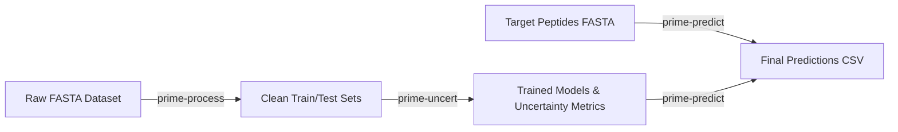

# PRIME: Peptide Representation & Property Prediction

**PRIME** is a modular toolkit designed for robust peptide property prediction and uncertainty estimation powered by protein language models (ESM-2).

---

## Key Highlights

- **ESM-Powered Embeddings**: Leverages transformer representations to capture complex biochemical and evolutionary features from sequence data alone.
- **Redundancy Reduction**: Integrates CD-HIT and sequence homology validation via BLAST to ensure rigorous, non-contaminated train/test partitioning.
- **Uncertainty & Robustness**: Multi-seed bootstrap evaluations, Monte Carlo Dropout, and SMOTE class imbalance compensation.
- **Ensemble Inference**: Evaluates target peptides across 15 models per feature and computes consensus probability and variance metrics.

---

## Workflow at a Glance

The PRIME pipeline consists of three core stages:

1. **`prime-process`**: Removes redundant sequences and splits datasets cleanly.
2. **`prime-uncert`**: Trains downstream neural network / logistic regression heads across multiple random seeds.
3. **`prime-predict`**: Runs ensemble inference on novel peptide candidates.

---

## Next Steps

- Check out the [Installation Guide](installation.md) to set up your environment.
- Follow the [Quickstart Guide](quickstart.md) to run your first pipeline.
- Read the [CLI Reference](cli/process.md) for full parameter documentation.
